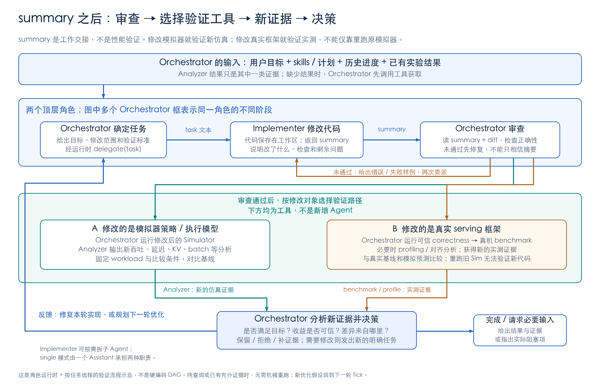
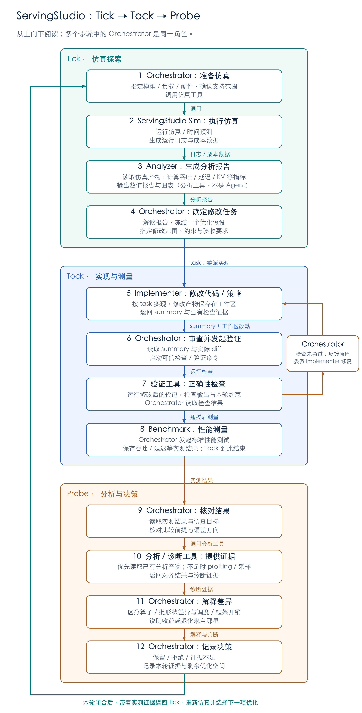

# Research presentations and architecture references

[Download the FFN pruning proposal](ffn-pruning-patent-proposal.pptx).
On GitHub, open the file and select **Download raw file** to save the editable PowerPoint.

The Chinese-language, three-slide deck covers limitations of existing pruning
strategies, a baseline parameter-count lower bound, and profiling-driven FFN
width selection. It is a proposed research design, not a supported simulator
feature or a report of validated accuracy or speedup. Parameter count is a
capacity proxy, not an accuracy guarantee. Patent claims require prior-art
review and professional review.

## ServingStudio architecture walkthrough

[Download the editable ServingStudio draw.io diagrams](servingstudio-architecture-six-pages.drawio).
Open the file in diagrams.net or draw.io; the page tabs contain the project
overview, Agent runtime, role contracts, optimization workflow, skills and tools,
and evaluation and memory. The revised overview identifies optional subagents
and persistent state, and the workflow shows implementation-review feedback. Page two
keeps the original role layout and adds a compact validation-feedback loop.
The orchestrator specifies the task scope and invokes validation; a separate data
arrow shows that validation consumes the implementer's edited artifacts. Simulator
or benchmark results inform the orchestrator's next implementation task. This
validation ownership follows the optimization skill; other skills may delegate
validation differently. The driver does not run a simulator automatically on handoff.

Page four uses a vertical, top-to-bottom Tick–Tock–Probe workflow with named
roles: Orchestrator → ServingStudio Sim → Analyzer → Orchestrator, then
Implementer, correctness checks,
benchmark measurement and attribution. It shows both the implementation repair
loop and the return to Tick after a recorded Probe decision.

This Chinese-language source walkthrough documents an external project. It does
not implement ServingStudio integration or claim measured performance gains in
LLMServingSim. It was reviewed on November 24, 2026 against the revisions pinned
by [ServingStudio](https://github.com/SyFI-ServingStudio/ServingStudio/tree/9a6654b9c1a73260624c478607359bf3ed9cf0c7):

- [Agent source](https://github.com/SyFI-ServingStudio/ServingStudioAgent/tree/ffb708b9c6eba58979aed29e64edac454132e605).
- [Simulator source and skills](https://github.com/SyFI-ServingStudio/ServingStudioSim/tree/5c7cd27b473613ea773661c6d87dd6fe757f1eed).
